<p align="center">
  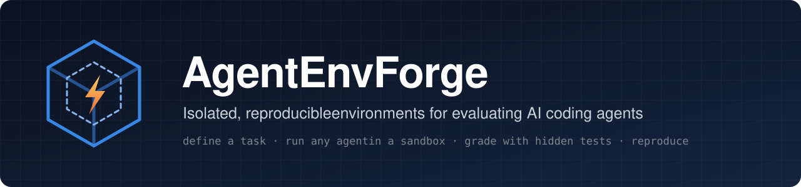
</p>

<p align="center">
  <a href="https://github.com/M-amir1998/AgentEnvForge/actions/workflows/ci.yml"></a>
  
  
  <a href="https://github.com/astral-sh/ruff"></a>
  <a href="LICENSE"></a>
  <a href="CHANGELOG.md"></a>
</p>

<p align="center">
  <b>Define a coding task once. Run any agent against it in a locked-down sandbox.<br>
  Grade the result with tests the agent never saw. Reproduce every run.</b>
</p>

<p align="center">
  <a href="#quick-start">Quick start</a> ·
  <a href="#how-it-works">How it works</a> ·
  <a href="#batch-experiments">Batch experiments</a> ·
  <a href="#results">Results</a> ·
  <a href="#documentation">Documentation</a>
</p>

<p align="center">
  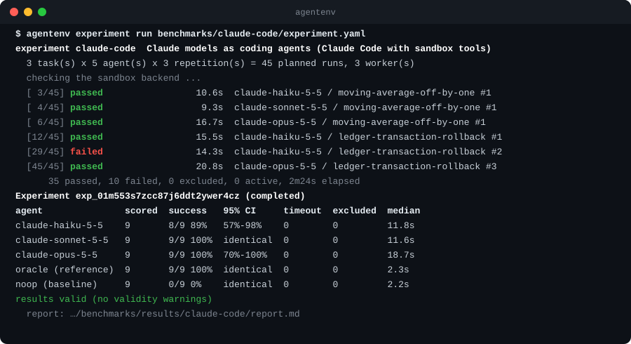
</p>

## Why AgentEnvForge

Evaluating a coding agent once, by hand, is easy. Doing it reproducibly for many tasks,
many agents and repeated trials is an infrastructure problem: isolation, resource limits,
hidden tests, timeouts, cleanup, provenance and statistics. AgentEnvForge is that
infrastructure. It is for people who build coding agents, create agent benchmarks,
generate RL rollouts or study failure modes, and it is provider-agnostic: no LLM SDK is a
dependency of the core.

<table>
<tr>
<td width="33%" valign="top">

**🔒 Isolated by default**<br>
Every run gets disposable Docker sandboxes: no network, non-root, all capabilities
dropped, CPU, memory and process limits, no host mounts.

</td>
<td width="33%" valign="top">

**🧪 Graded honestly**<br>
A *fresh* sandbox grades the solution with hidden tests, and edits to protected tests are
undone. A wrong solution and a broken environment are never confused.

</td>
<td width="33%" valign="top">

**🔁 Reproducible**<br>
Every run records content hashes of the task, source tree, image and hidden tests, and the
resolved commit; experiment runs add the full agent spec and seed.

</td>
</tr>
<tr>
<td valign="top">

**⚡ Batch experiments**<br>
Tasks × agents × repetitions with bounded concurrency, backpressure, a circuit breaker,
and Ctrl+C that stops cleanly and keeps the results.

</td>
<td valign="top">

**📊 Statistics, not anecdotes**<br>
Wilson intervals, pass@k, latency distributions and validity checks, exported as a
Markdown report, JSON, CSV and charts.

</td>
<td valign="top">

**🔌 Any agent**<br>
Programs inside the sandbox, Python adapters on the host, local models via Ollama, or
hosted Claude models via Claude Code, through one small interface.

</td>
</tr>
</table>

## Quick start

Requirements: Python 3.12+, [uv](https://docs.astral.sh/uv/), Docker (Desktop or Engine)
and git.

```bash
git clone https://github.com/M-amir1998/AgentEnvForge.git
cd AgentEnvForge
uv sync
uv run agentenv doctor     # checks Python, git, the Docker daemon, disk and database
```

Run the example task with its reference agent:

```bash
uv run agentenv run examples/basic/task.yaml --agent examples/basic/agents/reference.yaml
```

```text
AgentEnvForge  run run_01m44csm77277gf42f064mej0t  task ledger-transaction-rollback  agent command:reference-solver

  Validation           PASS     0.07s
  Source preparation   PASS     0.02s
  Sandbox build        PASS     9.02s      (0.03s on later runs: the image is cached)
  Sandbox start        PASS     0.37s
  Agent execution      PASS     1.25s
  Solution capture     PASS     0.23s
  Grader               PASS     2.18s
  Artifacts            PASS     0.01s
  Cleanup              PASS     0.12s

Result: SUCCESS  (2/2 graders passed)
Score:  1.000
  - hidden-tests: pass 7/7 tests passed
  - visible-tests: pass 2/2 tests passed
```

The same task with `--agent noop`, an agent that changes nothing, **fails** grading, so the
task really discriminates. Next, a real model:

```bash
# a hosted Claude model, through your Claude Code login (uses model capacity)
uv run agentenv run examples/off-by-one/task.yaml --agent examples/agents/claude-code/claude-haiku-5-5.yaml

# or a local model with Ollama: no API key, no GPU required
ollama pull qwen2.5-coder:7b
uv run agentenv run examples/off-by-one/task.yaml --agent examples/agents/ollama/qwen2.5-coder-7b.yaml --agent-timeout 1500
```

Every run can be inspected afterwards:

```bash
uv run agentenv runs list
uv run agentenv runs show <run-id> --events     # timings, provenance, event log
uv run agentenv runs artifacts <run-id>         # solution.patch, grader reports, logs
```

## How it works

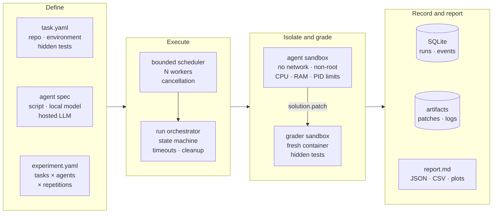

A **task** is a repository in a known state, the environment to run it in, and a way to
grade a solution, in a versioned YAML file. An **agent** is anything that can act through
a sandbox session. A **run** combines the two:

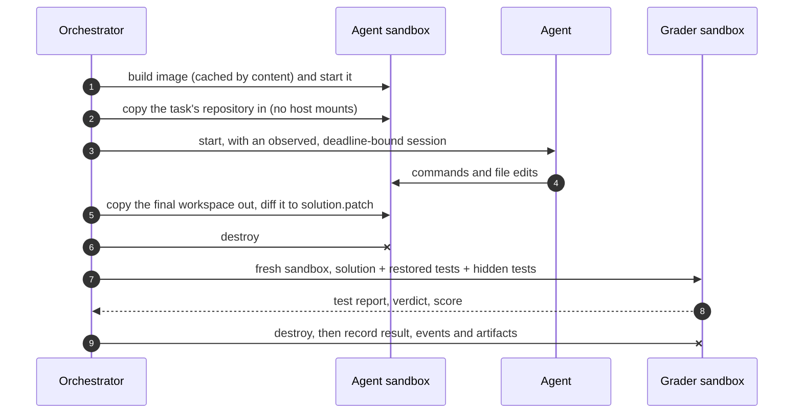

The hidden tests never exist in any container the agent can reach, and anything the agent
did outside its workspace (background processes, a fake `pytest`, edited tests) is gone
before grading starts.

<details>
<summary><b>The run lifecycle</b></summary>

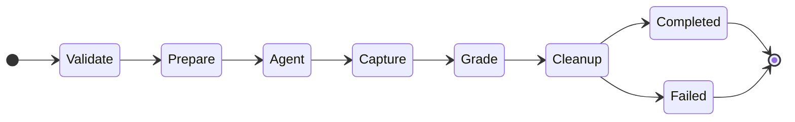

Every stage can jump straight to cleanup, and the terminal states are reachable only from
cleanup, so cleanup is attempted for every run: after crashes, timeouts and Ctrl+C alike.
A run that *completed* with a failing grade means the agent was wrong; `failed_*` states
mean the environment or the task could not be judged. Details:
[execution lifecycle](docs/architecture/execution-lifecycle.md).

</details>

<details>
<summary><b>What a task file looks like</b></summary>

```yaml
schema_version: "1"
id: ledger-transaction-rollback
name: Fix transaction rollback in the ledger store
instructions: |
  Transactions are supposed to be atomic: if the block raises, every change made inside
  the block must be undone and the exception must propagate to the caller. ...
source:
  type: local              # or git, pinned to a commit
  path: project
environment:
  dockerfile: environment/Dockerfile
  workspace: /workspace
  user: "1000:1000"
resources: {cpus: 1, memory_mb: 512, pids_limit: 256}
timeouts: {agent_seconds: 300, grader_seconds: 120}
network: {enabled: false}
grading:
  assets: grader           # hidden tests: copied into the grading sandbox only
  protected_paths: [tests] # restored before grading
  graders:
    - {type: pytest, name: hidden-tests, paths: [/grader/tests]}
    - {type: pytest, name: visible-tests, paths: [tests]}
```

`agentenv task validate` reports every problem at once, as `field / reason / received`.
Tutorial: [write your first task](docs/tutorials/first-task.md).

</details>

## Batch experiments

An **experiment** runs a matrix of tasks × agents × repetitions with bounded local
concurrency, then turns the results into statistics.

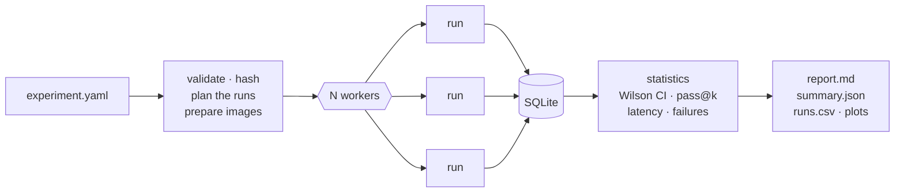

```yaml
schema_version: "1"
id: my-comparison
tasks:
  - examples/off-by-one/task.yaml
  - examples/lru-cache/task.yaml
agents:
  - id: claude-haiku
    spec: examples/agents/claude-code/claude-haiku-5-5.yaml
  - id: oracle               # applies the reference fix: must pass
    role: reference
    spec: examples/agents/oracle/oracle.yaml
  - id: noop                 # changes nothing: must fail
    role: baseline
    agent: {type: noop}
repetitions: 3
execution: {workers: 3}
```

```bash
uv run agentenv experiment validate my-comparison.yaml --preflight   # also checks the agents are ready
uv run agentenv experiment run my-comparison.yaml                    # Ctrl+C stops cleanly
uv run agentenv experiments list
uv run agentenv experiment report <experiment-id>                    # regenerate the results
```

```text
results/my-comparison/
├── report.md        validity, per-agent and per-task results, run times, failure analysis
├── summary.json     every statistic, machine-readable
├── runs.csv         one row per planned run: ready for pandas, R or a spreadsheet
├── failures.csv     failures by outcome, reason and stage
├── manifest.json    versions, hashes, agent provenance, images, host facts
└── plots/           success, task matrix, run time and outcome charts
```

**Reference** and **baseline** agents validate the tasks: a reference that fails, or a
baseline that passes, makes the results invalid. Runs that failed for reasons outside the
agent's control are excluded from success rates and reported separately. Tutorial:
[batch experiments](docs/tutorials/batch-experiments.md).

## Results

<picture>
  <source media="(prefers-color-scheme: dark)" srcset="docs/assets/readme/stats-dark.svg">
  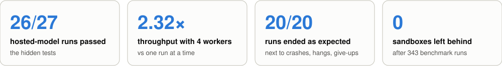
</picture>

<picture>
  <source media="(prefers-color-scheme: dark)" srcset="docs/assets/readme/claude-success-dark.svg">
  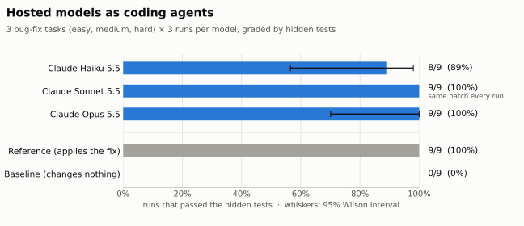
</picture>

Three Claude models, each driven by Claude Code and acting only through the sandbox, on an
easy, a medium and a hard bug-fix task, three runs each. The controls behaved: the
reference agent passed every run, the baseline none. With nine runs per model the
intervals overlap, so this is not a ranking, and these tasks are too easy to tell the
stronger models apart. **Hidden tests matter:** Haiku's one failure fixed two of three
bugs, passed the visible tests and reported success; the hidden tests caught it.

<picture>
  <source media="(prefers-color-scheme: dark)" srcset="docs/assets/readme/claude-time-cost-dark.svg">
  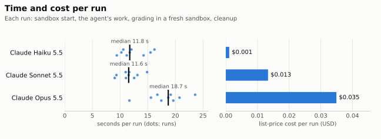
</picture>

<picture>
  <source media="(prefers-color-scheme: dark)" srcset="docs/assets/readme/scaling-dark.svg">
  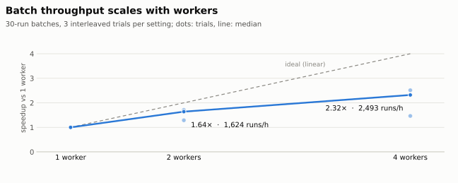
</picture>

<picture>
  <source media="(prefers-color-scheme: dark)" srcset="docs/assets/readme/isolation-dark.svg">
  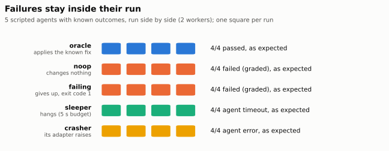
</picture>

<sub>Measured on a CPU-only laptop. Every number comes from the committed results in
[benchmarks/](benchmarks/README.md), which also hold the method, the raw data and the
commands to reproduce them.</sub>

## Agents

| Agent | Runs | Good for |
|---|---|---|
| `command` | inside the sandbox | any program or script; secrets injected and redacted |
| `python` | on the host, acting through the sandbox session | custom agents and LLM tool loops |
| [Claude Code](examples/agents/claude-code/README.md) | `claude -p` on the host; its only tools act in the sandbox | hosted Claude models (Haiku, Sonnet, Opus) |
| [Ollama](examples/agents/ollama/README.md) | tool loop on the host, local model | offline evaluation, no API key or GPU |
| `noop`, `manual` | built in | baselines; working a task by hand |

An adapter is a name and one method, `run(context) -> AgentResult`, acting through
`context.session` (run commands, read and write files) within the run's time budget. Tutorial:
[connect your own agent](docs/tutorials/custom-agent-adapter.md).

## Documentation

- **Tutorials:** [first task](docs/tutorials/first-task.md) · [custom agent](docs/tutorials/custom-agent-adapter.md) · [custom grader](docs/tutorials/custom-grader.md) · [batch experiments](docs/tutorials/batch-experiments.md)
- **Architecture:** [overview](docs/architecture/overview.md) · [execution lifecycle](docs/architecture/execution-lifecycle.md) · [experiments](docs/architecture/experiments.md) · [sandboxing](docs/architecture/sandboxing.md) · [security](docs/architecture/security.md) · [persistence](docs/architecture/persistence.md)
- **Decisions:** [architecture decision records](docs/adr/)
- **Reference:** [CLI](docs/reference/cli.md) · [benchmarks](benchmarks/README.md) · [status and known limitations](docs/development/status.md) · [roadmap](docs/design/roadmap.md) · [changelog](CHANGELOG.md)

> [!NOTE]
> Docker containers share the host kernel. Treat AgentEnvForge as a defence-in-depth
> boundary for semi-trusted code, not a VM-grade one ([security model](docs/architecture/security.md)).
> Stronger isolation (gVisor, Firecracker) is on the [roadmap](docs/design/roadmap.md).

## Development

```bash
make check        # ruff lint and format check, strict mypy, all tests
make test-unit    # fast, no Docker needed
make test-e2e     # complete runs of the example tasks (needs Docker)
uv run python scripts/readme_figures.py   # regenerate this README's charts from benchmarks/results
```

See [CONTRIBUTING.md](CONTRIBUTING.md) and the
[environment setup](docs/development/environment-setup.md).

## License

[Apache-2.0](LICENSE): permissive, with an explicit patent grant.
