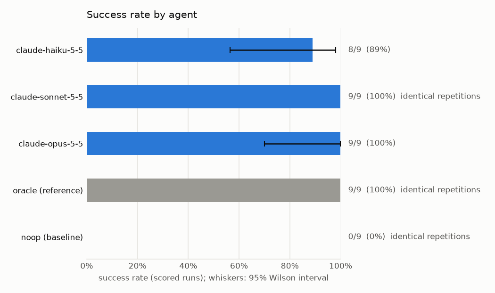
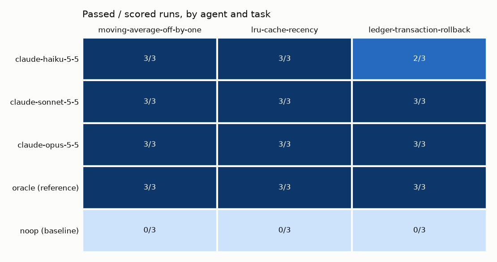
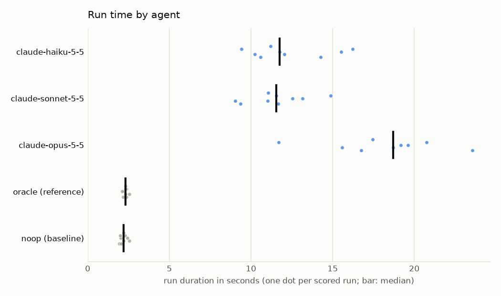
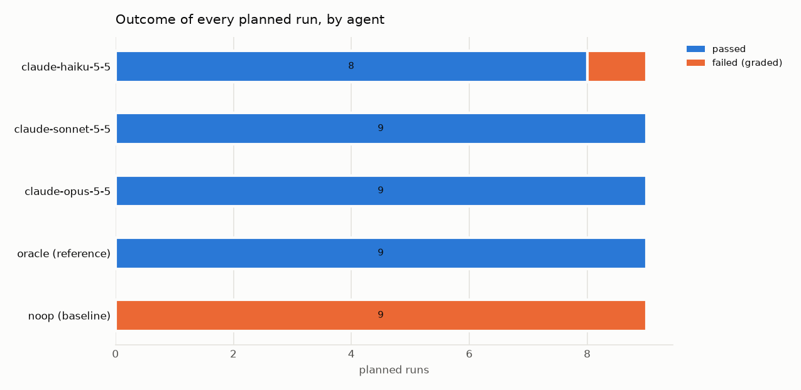

# Experiment report: Claude models as coding agents (Claude Code with sandbox tools)

Claude Haiku 5.5, Sonnet 5.5 and Opus 5.5 driven by Claude Code on an easy, a medium and a hard bug-fix task, three repetitions each, validated by an oracle and a noop baseline.

|  |  |
|---|---|
| Experiment ID | `exp_01m553s7zcc87j6ddt2ywer4cz` |
| Definition | `claude-code` (hash `93d337f9db8bf7bc`) |
| Status | completed |
| Planned runs | 45 = 3 tasks x 5 agents x 3 repetitions |
| Workers | 3 |
| Running time | 144.3 s (1122.9 runs/hour) |
| AgentEnvForge | 0.1.0.dev0 |
| Generated | 2026-10-17 14:30 UTC |

## Validity

No validity warnings: every planned run executed, no run failed for reasons outside the agents' control, and every reference/baseline check held.

## Environment

|  |  |
|---|---|
| OS | Windows 11 (AMD64) |
| CPU | not published |
| Memory | not published |
| GPU | not used (CPU-only execution) |
| Python | 3.12.10 |
| Sandbox backend | docker 29.8.1 (Docker Desktop) |

## Setup

### Tasks

| Task | Definition | Image |
|---|---|---|
| `moving-average-off-by-one` | `../../examples/off-by-one/task.yaml` | `sha256:d9b518c5eefa` |
| `lru-cache-recency` | `../../examples/lru-cache/task.yaml` | `sha256:7955c559c6bc` |
| `ledger-transaction-rollback` | `../../examples/basic/task.yaml` | `sha256:a5863c4d57ea` |

### Agents

| Agent | Role | Adapter | Provenance | Time budget |
|---|---|---|---|---|
| `claude-haiku-5-5` | subject | `claude-code:claude-haiku-5-5` | - | 600 s |
| `claude-sonnet-5-5` | subject | `claude-code:claude-sonnet-5-5` | - | 600 s |
| `claude-opus-5-5` | subject | `claude-code:claude-opus-5-5` | - | 600 s |
| `oracle` | reference | `command:oracle` | - | task default |
| `noop` | baseline | `noop` | - | task default |

Repetitions use seeds `0` .. `2` (offered to agents that support seeding). Runs were scheduled in interleaved rounds with the agent order shuffled per block.

## Results by agent

Success = passed / scored runs. Intervals are 95% Wilson score intervals, pooled over this experiment's tasks, so they describe *these tasks*, not general capability. Reference and baseline agents validate the tasks and are not compared with subjects.

| Agent | Role | Model / adapter | Scored | Success [95% CI] | Mean over tasks | pass@k | Timeouts | Excluded |
|---|---|---|---|---|---|---|---|---|
| `claude-haiku-5-5` | subject | `claude-haiku-5-5` | 9 | 8/9 = 89% [57%, 98%] | 89% | pass@3 = 1.00 | 0 | 0 |
| `claude-sonnet-5-5` | subject | `claude-sonnet-5-5` | 9 | 9/9 = 100% (identical repetitions) | 100% | - (identical repetitions: pass@k equals pass@1) | 0 | 0 |
| `claude-opus-5-5` | subject | `claude-opus-5-5` | 9 | 9/9 = 100% [70%, 100%] | 100% | pass@3 = 1.00 | 0 | 0 |
| `oracle` | reference | `command:oracle` | 9 | 9/9 = 100% (identical repetitions) | 100% | - (identical repetitions: pass@k equals pass@1) | 0 | 0 |
| `noop` | baseline | `noop` | 9 | 0/9 = 0% (identical repetitions) | 0% | - (identical repetitions: pass@k equals pass@1) | 0 | 0 |

## Results by agent and task

Passed / scored runs.

| Agent | `moving-average-off-by-one` | `lru-cache-recency` | `ledger-transaction-rollback` |
|---|---|---|---|
| `claude-haiku-5-5` | 3/3 (identical) | 3/3 | 2/3 |
| `claude-sonnet-5-5` | 3/3 (identical) | 3/3 (identical) | 3/3 (identical) |
| `claude-opus-5-5` | 3/3 (identical) | 3/3 (identical) | 3/3 |
| `oracle` | 3/3 (identical) | 3/3 (identical) | 3/3 (identical) |
| `noop` | 0/3 (identical) | 0/3 (identical) | 0/3 (identical) |

## Results by task (subject agents)

| Task | Success [95% CI] | Reference passed every run | Baseline failed every run |
|---|---|---|---|
| `moving-average-off-by-one` | 9/9 = 100% [70%, 100%] | yes | yes |
| `lru-cache-recency` | 9/9 = 100% [70%, 100%] | yes | yes |
| `ledger-transaction-rollback` | 8/9 = 89% [57%, 98%] | yes | yes |

## Run time

Seconds over scored runs. `>=`: some runs hit their time budget, so the value is a lower bound.

| Agent | n | Mean | Median | p95 | Min | Max |
|---|---|---|---|---|---|---|
| `claude-haiku-5-5` | 9 | 12.4 | 11.8 | - (n<20) | 9.4 | 16.2 |
| `claude-sonnet-5-5` | 9 | 11.6 | 11.6 | - (n<20) | 9.0 | 14.9 |
| `claude-opus-5-5` | 9 | 18.1 | 18.7 | - (n<20) | 11.7 | 23.6 |
| `oracle` | 9 | 2.3 | 2.3 | - (n<20) | 2.1 | 2.5 |
| `noop` | 9 | 2.2 | 2.2 | - (n<20) | 1.9 | 2.6 |

### Model usage

| Agent | Prompt tokens | Completion tokens | Generation speed |
|---|---|---|---|
| `claude-haiku-5-5` | 73,599 | 10,132 | - |
| `claude-sonnet-5-5` | 63,739 | 5,775 | - |
| `claude-opus-5-5` | 69,365 | 8,173 | - |

## Failure analysis

| Outcome | Reason | Stage | Runs |
|---|---|---|---|
| failed | graded_failure | - | 10 |

| Outcome | Runs |
|---|---|
| passed | 35 |
| failed | 10 |

## Plots

## Method

- A run is **scored** once its agent started (unless cancelled). Failures before the agent started, sandbox start failures, cancellations and unavailable model servers are excluded from success rates and reported separately.
- Failures after the agent started that prevent grading (e.g. the solution breaks the test configuration) count as failures (`post_agent_error`).
- Cells whose repetitions produced the same outcome *and* the same patch are marked identical and count as one observation (no interval, no pass@k): a deterministic agent looks like this, and so does a sampled one that converges on the same patch.
- pass@k uses the unbiased estimator of Chen et al. (2021), averaged over tasks.
- p95 is reported only for at least 20 runs.

## Files

- [`experiment.yaml`](experiment.yaml)
- [`manifest.json`](manifest.json)
- [`environment.json`](environment.json)
- [`summary.json`](summary.json)
- [`runs.csv`](runs.csv)
- [`failures.csv`](failures.csv)
- [`report.md`](report.md)
- [`artifacts/`](artifacts/)

Individual runs remain inspectable with `agentenv runs show <run id>`.
