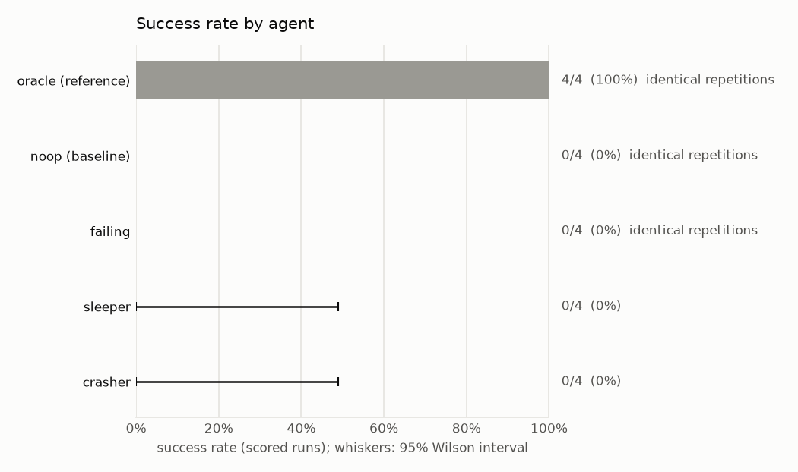
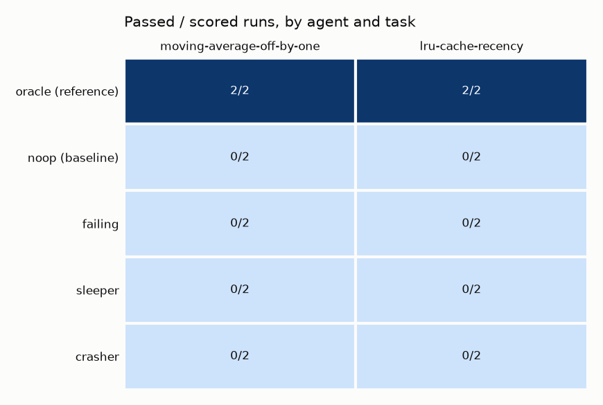
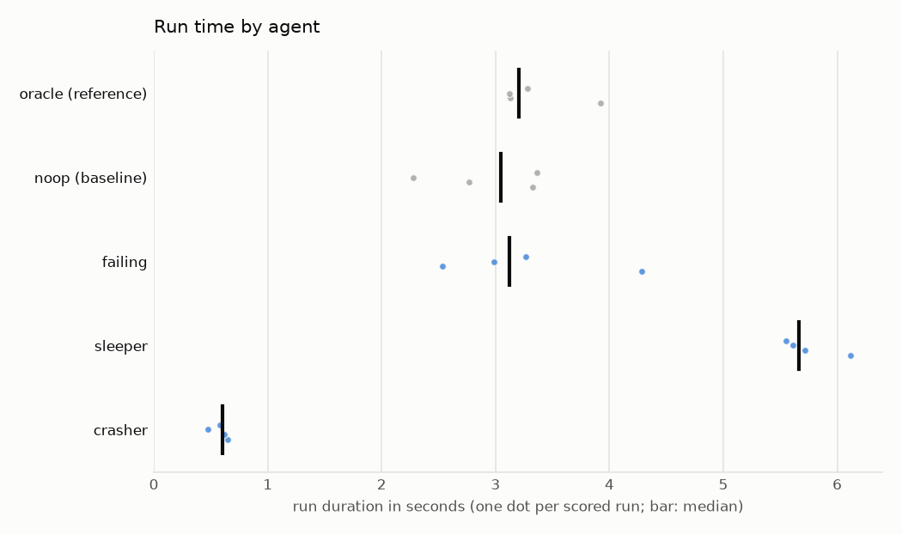
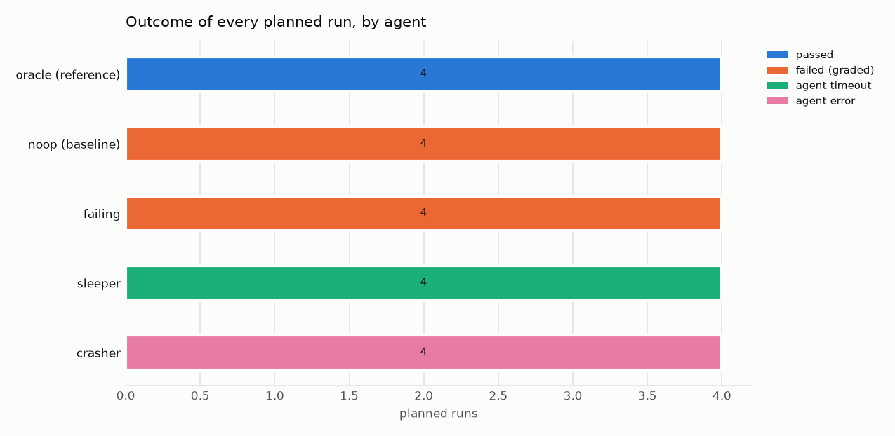

# Experiment report: Failure isolation under concurrency

Deterministic agents with known outcomes (pass, graded failure, agent timeout, adapter crash) run side by side; each failure must stay inside its own run.

|  |  |
|---|---|
| Experiment ID | `exp_01m53d0yve1a42mccqhd3mp0an` |
| Definition | `failure-isolation` (hash `4c5f3d7325a1caec`) |
| Status | completed |
| Planned runs | 20 = 2 tasks x 5 agents x 2 repetitions |
| Workers | 2 |
| Running time | 32.1 s (2243.2 runs/hour) |
| AgentEnvForge | 0.1.0.dev0 |
| Generated | 2026-10-16 22:24 UTC |

## Validity

No validity warnings: every planned run executed, no run failed for reasons outside the agents' control, and every reference/baseline check held.

## Environment

|  |  |
|---|---|
| OS | Windows 11 (AMD64) |
| CPU | not published |
| Memory | not published |
| GPU | not used (CPU-only execution) |
| Python | 3.12.10 |
| Sandbox backend | docker 29.8.1 (Docker Desktop) |

## Setup

### Tasks

| Task | Definition | Image |
|---|---|---|
| `moving-average-off-by-one` | `../../examples/off-by-one/task.yaml` | `sha256:d9b518c5eefa` |
| `lru-cache-recency` | `../../examples/lru-cache/task.yaml` | `sha256:7955c559c6bc` |

### Agents

| Agent | Role | Adapter | Provenance | Time budget |
|---|---|---|---|---|
| `oracle` | reference | `command:oracle` | - | task default |
| `noop` | baseline | `noop` | - | task default |
| `failing` | subject | `command:failing` | - | task default |
| `sleeper` | subject | `command:sleeper` | - | 5 s |
| `crasher` | subject | `crasher` | - | task default |

Repetitions use seeds `0` .. `1` (offered to agents that support seeding). Runs were scheduled in interleaved rounds with the agent order shuffled per block.

## Results by agent

Success = passed / scored runs. Intervals are 95% Wilson score intervals, pooled over this experiment's tasks, so they describe *these tasks*, not general capability. Reference and baseline agents validate the tasks and are not compared with subjects.

| Agent | Role | Model / adapter | Scored | Success [95% CI] | Mean over tasks | pass@k | Timeouts | Excluded |
|---|---|---|---|---|---|---|---|---|
| `oracle` | reference | `command:oracle` | 4 | 4/4 = 100% (deterministic) | 100% | - (deterministic agent: pass@k equals pass@1) | 0 | 0 |
| `noop` | baseline | `noop` | 4 | 0/4 = 0% (deterministic) | 0% | - (deterministic agent: pass@k equals pass@1) | 0 | 0 |
| `failing` | subject | `command:failing` | 4 | 0/4 = 0% (deterministic) | 0% | - (deterministic agent: pass@k equals pass@1) | 0 | 0 |
| `sleeper` | subject | `command:sleeper` | 4 | 0/4 = 0% [0%, 49%] | 0% | pass@2 = 0.00 | 4 | 0 |
| `crasher` | subject | `crasher` | 4 | 0/4 = 0% [0%, 49%] | 0% | pass@2 = 0.00 | 0 | 0 |

## Results by agent and task

Passed / scored runs.

| Agent | `moving-average-off-by-one` | `lru-cache-recency` |
|---|---|---|
| `oracle` | 2/2 (identical) | 2/2 (identical) |
| `noop` | 0/2 (identical) | 0/2 (identical) |
| `failing` | 0/2 (identical) | 0/2 (identical) |
| `sleeper` | 0/2 | 0/2 |
| `crasher` | 0/2 | 0/2 |

## Results by task (subject agents)

| Task | Success [95% CI] | Reference passed every run | Baseline failed every run |
|---|---|---|---|
| `moving-average-off-by-one` | 0/6 = 0% [0%, 39%] | yes | yes |
| `lru-cache-recency` | 0/6 = 0% [0%, 39%] | yes | yes |

## Run time

Seconds over scored runs. `>=`: some runs hit their time budget, so the value is a lower bound.

| Agent | n | Mean | Median | p95 | Min | Max |
|---|---|---|---|---|---|---|
| `oracle` | 4 | 3.4 | 3.2 | - (n<20) | 3.1 | 3.9 |
| `noop` | 4 | 2.9 | 3.0 | - (n<20) | 2.3 | 3.4 |
| `failing` | 4 | 3.3 | 3.1 | - (n<20) | 2.5 | 4.3 |
| `sleeper` | 4 | >=5.7 | 5.7 | - (n<20) | 5.6 | >=6.1 |
| `crasher` | 4 | 0.6 | 0.6 | - (n<20) | 0.5 | 0.7 |

## Failure analysis

| Outcome | Reason | Stage | Runs |
|---|---|---|---|
| agent_error | agent_error | running_agent | 4 |
| agent_timeout | agent_timeout | running_agent | 4 |
| failed | graded_failure | - | 8 |

| Outcome | Runs |
|---|---|
| passed | 4 |
| failed | 8 |
| agent_timeout | 4 |
| agent_error | 4 |

## Plots

## Method

- A run is **scored** once its agent started (unless cancelled). Failures before the agent started, sandbox start failures, cancellations and unavailable model servers are excluded from success rates and reported separately.
- Failures after the agent started that prevent grading (e.g. the solution breaks the test configuration) count as failures (`post_agent_error`).
- Cells whose repetitions produced the same outcome *and* the same patch are marked identical; deterministic agents get no interval and no pass@k.
- pass@k uses the unbiased estimator of Chen et al. (2021), averaged over tasks.
- p95 is reported only for at least 20 runs.

## Files

- [`experiment.yaml`](experiment.yaml)
- [`manifest.json`](manifest.json)
- [`environment.json`](environment.json)
- [`summary.json`](summary.json)
- [`runs.csv`](runs.csv)
- [`failures.csv`](failures.csv)
- [`report.md`](report.md)

Individual runs remain inspectable with `agentenv runs show <run id>`.
