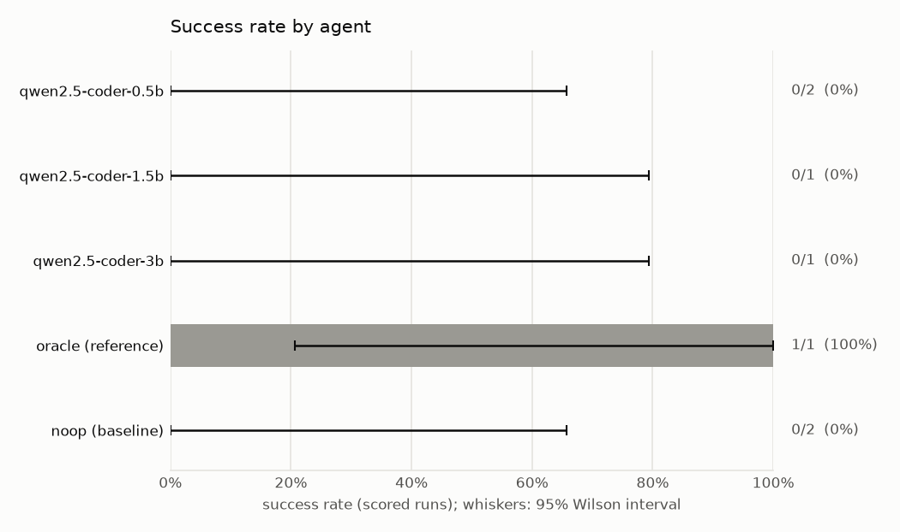
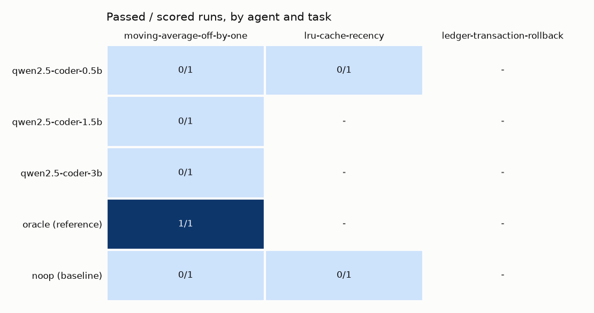
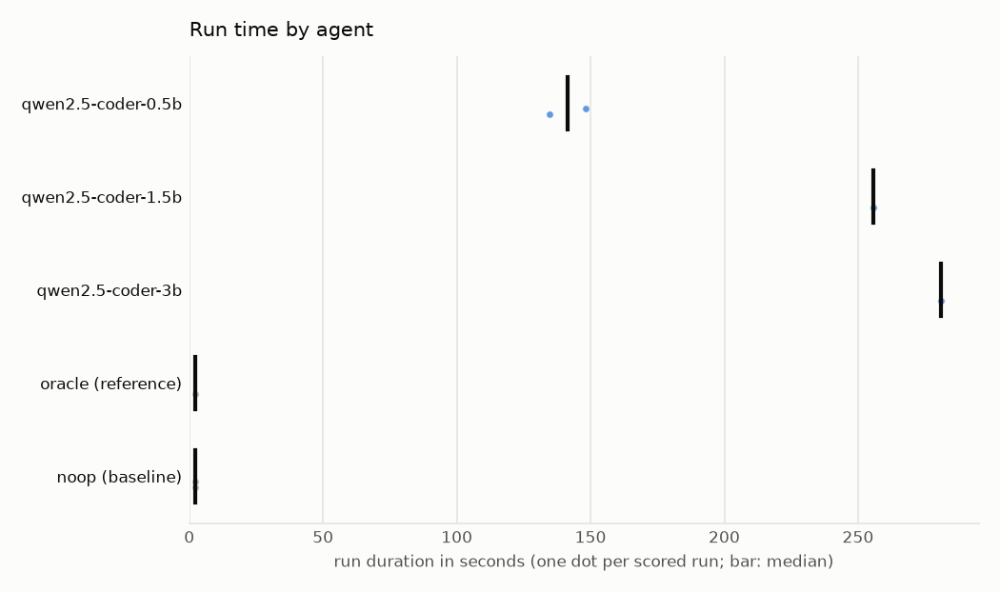
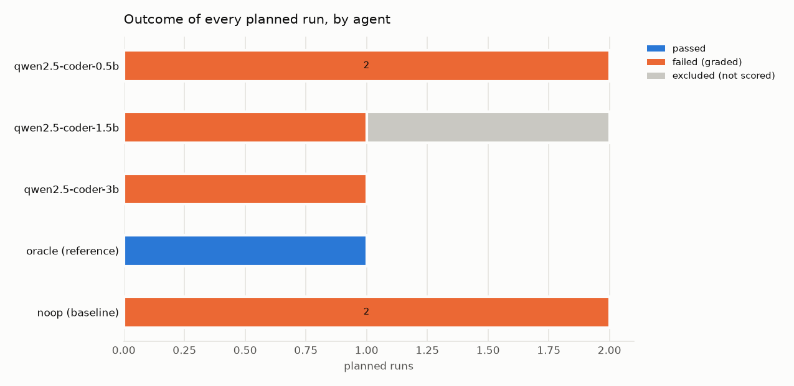

# Experiment report: Tiny local coding models (Ollama, CPU only)

qwen2.5-coder 0.5b, 1.5b and 3b (Q4_K_M, CPU only) on an easy, a medium and a hard bug-fix task, three seeded repetitions each, validated by an oracle and a noop baseline.

|  |  |
|---|---|
| Experiment ID | `exp_01m53d2hafgg6143v55h2fdcep` |
| Definition | `local-ollama` (hash `becf3541fa1a4f73`) |
| Status | cancelled (partial) |
| Planned runs | 45 = 3 tasks x 5 agents x 3 repetitions |
| Workers | 1 |
| Running time | 930.3 s (31.0 runs/hour) |
| AgentEnvForge | 0.1.0.dev0 |
| Generated | 2026-10-17 14:30 UTC |

## Validity

- **Warning:** partial experiment: 37 runs not started and 0 incomplete; rates cover only the runs that finished

## Environment

|  |  |
|---|---|
| OS | Windows 11 (AMD64) |
| CPU | not published |
| Memory | not published |
| GPU | not used (CPU-only execution) |
| Python | 3.12.10 |
| Sandbox backend | docker 29.8.1 (Docker Desktop) |

## Setup

### Tasks

| Task | Definition | Image |
|---|---|---|
| `moving-average-off-by-one` | `../../examples/off-by-one/task.yaml` | `sha256:d9b518c5eefa` |
| `lru-cache-recency` | `../../examples/lru-cache/task.yaml` | `sha256:7955c559c6bc` |
| `ledger-transaction-rollback` | `../../examples/basic/task.yaml` | `sha256:a5863c4d57ea` |

### Agents

| Agent | Role | Adapter | Provenance | Time budget |
|---|---|---|---|---|
| `qwen2.5-coder-0.5b` | subject | `ollama:qwen2.5-coder:0.5b` | model_digest=4ff64a7f502a08b7616edb8ca0a79eb1853fc363d842b7df4b46915d11a3fb09, quantization=Q4_K_M, parameter_size=494.03M, temperature=0.2, ollama_version=0.40.5 | 600 s |
| `qwen2.5-coder-1.5b` | subject | `ollama:qwen2.5-coder:1.5b` | model_digest=d7372fd828518a4d38b1eb196c673c31a85f2ed302b3d1e406c4c2d1b64a0668, quantization=Q4_K_M, parameter_size=1.5B, temperature=0.2, ollama_version=0.40.5 | 600 s |
| `qwen2.5-coder-3b` | subject | `ollama:qwen2.5-coder:3b` | model_digest=f72c60cabf6237b07f6e632b2c48d533cef25eda2efbd34bed21c5e9c01e6225, quantization=Q4_K_M, parameter_size=3.1B, temperature=0.2, ollama_version=0.40.5 | 600 s |
| `oracle` | reference | `command:oracle` | - | task default |
| `noop` | baseline | `noop` | - | task default |

Repetitions use seeds `0` .. `2` (offered to agents that support seeding). Runs were scheduled in interleaved rounds with the agent order shuffled per block.

## Results by agent

Success = passed / scored runs. Intervals are 95% Wilson score intervals, pooled over this experiment's tasks, so they describe *these tasks*, not general capability. Reference and baseline agents validate the tasks and are not compared with subjects.

| Agent | Role | Model / adapter | Scored | Success [95% CI] | Mean over tasks | pass@k | Timeouts | Excluded |
|---|---|---|---|---|---|---|---|---|
| `qwen2.5-coder-0.5b` | subject | `qwen2.5-coder:0.5b` | 2 | 0/2 = 0% [0%, 66%] | - | - (fewer than 3 scored runs on: moving-average-off-by-one, lru-cache-recency, ledger-transaction-rollback) | 0 | 7 |
| `qwen2.5-coder-1.5b` | subject | `qwen2.5-coder:1.5b` | 1 | 0/1 = 0% [0%, 79%] | - | - (fewer than 3 scored runs on: moving-average-off-by-one, lru-cache-recency, ledger-transaction-rollback) | 0 | 8 |
| `qwen2.5-coder-3b` | subject | `qwen2.5-coder:3b` | 1 | 0/1 = 0% [0%, 79%] | - | - (fewer than 3 scored runs on: moving-average-off-by-one, lru-cache-recency, ledger-transaction-rollback) | 0 | 8 |
| `oracle` | reference | `command:oracle` | 1 | 1/1 = 100% [21%, 100%] | - | - (fewer than 3 scored runs on: moving-average-off-by-one, lru-cache-recency, ledger-transaction-rollback) | 0 | 8 |
| `noop` | baseline | `noop` | 2 | 0/2 = 0% [0%, 66%] | - | - (fewer than 3 scored runs on: moving-average-off-by-one, lru-cache-recency, ledger-transaction-rollback) | 0 | 7 |

## Results by agent and task

Passed / scored runs.

| Agent | `moving-average-off-by-one` | `lru-cache-recency` | `ledger-transaction-rollback` |
|---|---|---|---|
| `qwen2.5-coder-0.5b` | 0/1 | 0/1 | 0/0 |
| `qwen2.5-coder-1.5b` | 0/1 | 0/0 | 0/0 |
| `qwen2.5-coder-3b` | 0/1 | 0/0 | 0/0 |
| `oracle` | 1/1 | 0/0 | 0/0 |
| `noop` | 0/1 | 0/1 | 0/0 |

## Results by task (subject agents)

| Task | Success [95% CI] | Reference passed every run | Baseline failed every run |
|---|---|---|---|
| `moving-average-off-by-one` | 0/3 = 0% [0%, 56%] | yes | yes |
| `lru-cache-recency` | 0/1 = 0% [0%, 79%] | - | yes |
| `ledger-transaction-rollback` | - (no scored runs) | - | - |

## Run time

Seconds over scored runs. `>=`: some runs hit their time budget, so the value is a lower bound.

| Agent | n | Mean | Median | p95 | Min | Max |
|---|---|---|---|---|---|---|
| `qwen2.5-coder-0.5b` | 2 | 141.5 | 141.5 | - (n<20) | 134.7 | 148.2 |
| `qwen2.5-coder-1.5b` | 1 | 255.8 | 255.8 | - (n<20) | 255.8 | 255.8 |
| `qwen2.5-coder-3b` | 1 | 281.1 | 281.1 | - (n<20) | 281.1 | 281.1 |
| `oracle` | 1 | 2.4 | 2.4 | - (n<20) | 2.4 | 2.4 |
| `noop` | 2 | 2.3 | 2.3 | - (n<20) | 2.2 | 2.4 |

### Model usage

| Agent | Prompt tokens | Completion tokens | Generation speed |
|---|---|---|---|
| `qwen2.5-coder-0.5b` | 113,334 | 1,698 | 25.8 tokens/s |
| `qwen2.5-coder-1.5b` | 51,161 | 1,829 | 12.4 tokens/s |
| `qwen2.5-coder-3b` | 43,115 | 1,033 | 7.7 tokens/s |

## Failure analysis

| Outcome | Reason | Stage | Runs |
|---|---|---|---|
| cancelled | cancelled | running_agent | 1 |
| failed | graded_failure | - | 6 |

| Outcome | Runs |
|---|---|
| passed | 1 |
| failed | 6 |
| cancelled | 1 |
| not_started | 37 |

## Plots

## Method

- A run is **scored** once its agent started (unless cancelled). Failures before the agent started, sandbox start failures, cancellations and unavailable model servers are excluded from success rates and reported separately.
- Failures after the agent started that prevent grading (e.g. the solution breaks the test configuration) count as failures (`post_agent_error`).
- Cells whose repetitions produced the same outcome *and* the same patch are marked identical and count as one observation (no interval, no pass@k): a deterministic agent looks like this, and so does a sampled one that converges on the same patch.
- pass@k uses the unbiased estimator of Chen et al. (2021), averaged over tasks.
- p95 is reported only for at least 20 runs.

## Files

- [`experiment.yaml`](experiment.yaml)
- [`manifest.json`](manifest.json)
- [`environment.json`](environment.json)
- [`summary.json`](summary.json)
- [`runs.csv`](runs.csv)
- [`failures.csv`](failures.csv)
- [`report.md`](report.md)
- [`artifacts/`](artifacts/)

Individual runs remain inspectable with `agentenv runs show <run id>`.
