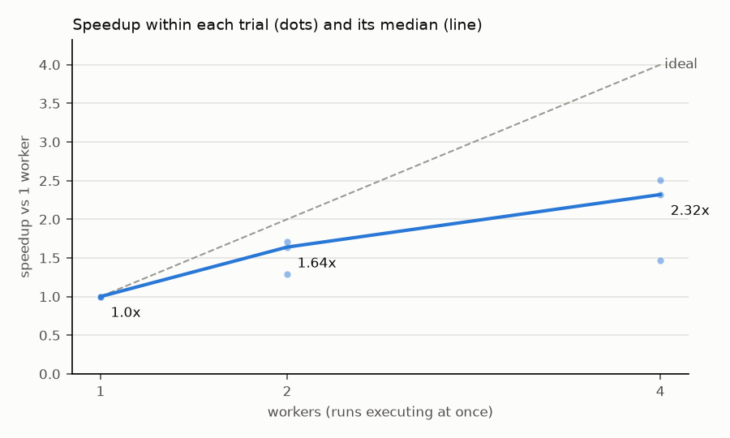

# Scaling benchmark: batch execution overhead

Measured 2026-10-16 with AgentEnvForge 0.1.0.dev0: 30 runs per trial (`benchmarks/infrastructure/experiment.yaml`), 3 interleaved trial(s) per worker count.

Machine: a laptop, Windows 11; Docker 29.8.1 (Docker Desktop). CPU only.

| Workers | Running time (median, min-max) | Throughput | Speedup (median, min-max) | Efficiency | Median run | Valid | Cleanup | Leftovers |
|---|---|---|---|---|---|---|---|---|
| 1 | 108.8 s (87.9-125.4) | 993 runs/h | 1.0x (1.0-1.0) | 100% | 3.47 s | yes | ok | 0 |
| 2 | 66.5 s (51.4-97.4) | 1624 runs/h | 1.64x (1.29-1.71) | 82% | 4.1 s | yes | ok | 0 |
| 4 | 43.3 s (37.9-85.6) | 2493 runs/h | 2.32x (1.47-2.51) | 58% | 5.34 s | yes | ok | 0 |

Every trial, in execution order:

| Trial | Workers | Running time | Wall time | Speedup in trial | Median run | Valid |
|---|---|---|---|---|---|---|
| 1 | 1 | 125.4 s | 130.1 s | 1.00x | 3.47 s | yes |
| 1 | 4 | 85.6 s | 89.8 s | 1.47x | 8.45 s | yes |
| 1 | 2 | 97.4 s | 100.8 s | 1.29x | 5.49 s | yes |
| 2 | 4 | 43.3 s | 46.4 s | 2.51x | 5.34 s | yes |
| 2 | 2 | 66.5 s | 69.3 s | 1.64x | 4.10 s | yes |
| 2 | 1 | 108.8 s | 112.0 s | 1.00x | 3.50 s | yes |
| 3 | 1 | 87.9 s | 90.8 s | 1.00x | 2.75 s | yes |
| 3 | 2 | 51.4 s | 54.3 s | 1.71x | 3.37 s | yes |
| 3 | 4 | 37.9 s | 39.9 s | 2.32x | 5.08 s | yes |

- *Running time*: first run started to last run finished (image preparation excluded).
- *Speedup*: per trial, the 1-worker running time divided by the N-worker running time of the same trial; the table shows the median and range over trials. Within a trial the worker counts ran back to back, so drift between trials (see the trial table) cancels out.
- *Median run*: median duration of a single run; it grows with N because concurrent runs share the CPU, disk and the Docker daemon.
- *Valid*: every oracle run passed and every noop run failed, at every worker count.
- The agents are deterministic and near-instant, so this measures AgentEnvForge and Docker overhead, not agent performance. Results depend on the machine.
